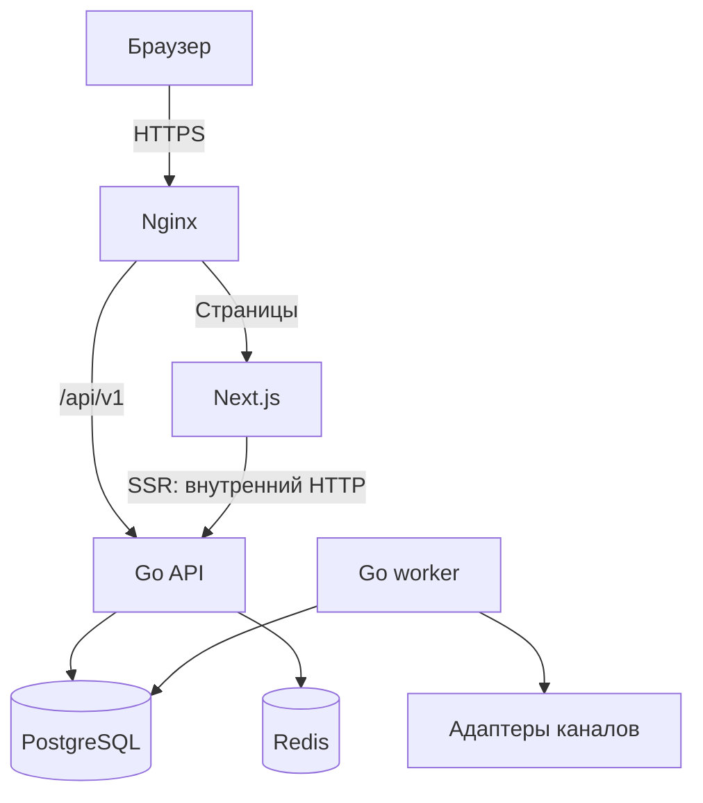

# TODO App

Веб-приложение для управления задачами с личным кабинетом, статистикой выполнения и напоминаниями через подключаемые каналы.

Проект объединяет **Next.js + TypeScript**, **Go**, **PostgreSQL** и **Redis**. Приложение и инфраструктура разворачиваются в Docker через CI/CD; логи и метрики доступны в Grafana.

> **Статус: проектирование.** README описывает целевой состав проекта и принятые технические решения. Реализация, команды запуска и адрес демо будут добавляться по мере готовности. Перечисленные функции пока не означают завершённую разработку.

## О проекте

TODO App развивается из учебного задания по Go в самостоятельный pet-проект с полноценным интерфейсом и подготовкой к эксплуатации.

Основной сценарий: зарегистрироваться → создать задачу → настроить напоминание → выполнить задачу → увидеть результат в статистике.

Цель проекта — пройти весь цикл разработки: от контракта API и правил предметной области до автоматического деплоя, мониторинга, отката и восстановления данных.

## Возможности

| Область | Планируемые функции |
| --- | --- |
| Аккаунт | Регистрация, вход, выход, обновление сессии, завершение всех сессий |
| Профиль | Просмотр и изменение имени и телефона |
| Задачи | Создание, просмотр, редактирование, удаление, завершение и повторное открытие |
| Список задач | Пагинация и фильтрация по состоянию; выбор автора для администратора |
| Статистика | Количество созданных и завершённых задач, процент выполнения, среднее время выполнения |
| Напоминания | Выбор времени, перенос и отмена; прекращение напоминаний по завершённой или удалённой задаче |
| Уведомления | Центр уведомлений, подключение каналов, настройки категорий и история доставки |
| Администрирование | Управление пользователями, доступ к задачам и статистике в рамках роли |

Первая версия включает личные задачи, JWT-аутентификацию, Redis-кэш статистики, уведомления внутри приложения и Telegram. Email и Web Push запланированы следующими этапами.

## Стек

| Компонент | Технологии и назначение |
| --- | --- |
| Frontend | Next.js App Router, TypeScript в строгом режиме, pnpm |
| Backend | Go, REST API, модульная структура, отдельный процесс фоновых задач |
| Контракт | OpenAPI и типизированный TypeScript-клиент |
| База данных | PostgreSQL, SQL-миграции, ограничения целостности |
| Кэш | Redis, cache-aside, TTL и инвалидация после изменения данных |
| Аутентификация | JWT access token, ротация refresh token, Argon2id для паролей |
| Входящий трафик | Nginx, HTTPS, маршрутизация и ограничения запросов |
| Контейнеры | Docker, Docker Compose, отдельные конфигурации окружений |
| Доставка | GitLab CI/CD и Container Registry |
| Метрики | Prometheus |
| Логи | Grafana Alloy → Loki |
| Дашборды и технические оповещения | Grafana и Grafana Alerting |

Версии зависимостей и образов закрепляются при создании каркаса проекта. Staging и production получают одни и те же проверенные образы.

## Архитектура

Backend строится как модульный монолит. Go API обрабатывает запросы, а отдельный Go worker выполняет напоминания и доставку уведомлений. Оба процесса используют общие модули одного репозитория.

- **Next.js** отвечает за страницы, формы, SSR и состояния интерфейса.
- **Go** проверяет сессии, права, входные данные и бизнес-правила.
- **PostgreSQL** хранит пользователей, задачи, сессии и задания доставки.
- **Redis** ускоряет чтение; приложение допускает полную потерю кэша.
- **Nginx** служит публичной точкой входа. Порты приложений, БД и Redis доступны во внутренней сети.

Браузер обращается к API по относительному пути `/api/v1`. Next.js использует внутренний адрес Go для SSR. Персональные ответы не попадают в общий кэш страниц или прокси.

## Модель данных и правила

### Пользователи

- Имя: от 3 до 100 символов после удаления пробелов по краям.
- Телефон необязателен: от 10 до 15 символов, начальный `+` и цифры; плюс включён в длину.
- Длины текстовых полей считаются в Unicode code points, а не байтах.
- Учётные данные и сессии хранятся отдельно от публичного профиля.
- Удаление пользователя с существующими задачами запрещено: API возвращает `409 Conflict`.

### Задачи

| Поле | Назначение |
| --- | --- |
| `id` | Идентификатор задачи |
| `user_id` | Автор; для обычного пользователя определяется из сессии |
| `title` | Название, от 1 до 100 символов |
| `description` | Необязательное описание, от 1 до 1000 символов при наличии |
| `completed` | Обязательный признак выполнения |
| `created_at` | Дата создания, устанавливаемая системой |
| `completed_at` | Дата выполнения или `null` |
| `due_at` | Необязательный срок; добавляется вместе с напоминаниями |
| `version` | Версия для защиты от одновременного перезаписывания |

Автор существующей задачи в первой версии не меняется. При переходе `false → true` система устанавливает `completed_at`; повторное `true` сохраняет дату. При повторном открытии дата очищается. Завершение не может предшествовать созданию.

Время хранится в UTC в PostgreSQL `timestamptz`, передаётся в RFC 3339 и отображается в часовом поясе пользователя.

Для `PATCH` отсутствие поля означает «не менять», `null` очищает только nullable-поле, а переданное значение заменяет текущее. Значение `false` отличается от отсутствующего поля. Устаревшая `version` приводит к `409 Conflict`.

### Статистика

Отчёт строится по задачам, **созданным в интервале `[from, to)`**. Их завершённость оценивается на момент запроса.

- Создано: количество задач в выбранной группе.
- Завершено: количество задач с `completed = true` в этой группе.
- Процент выполнения: `completed / created × 100`; для пустой группы — `0`.
- Среднее время выполнения: среднее `completed_at − created_at` только завершённых задач; при их отсутствии — `null`.

Удаление или повторное открытие задачи меняет отчёт. Неизменяемая историческая аналитика потребует отдельного журнала событий и не входит в первую версию.

## Аутентификация и доступ

Используется короткоживущий JWT access token и случайный непрозрачный refresh token.

- Начальные сроки: access token — **10 минут**, абсолютный срок сессии — **7 дней**; параметры задаются конфигурацией.
- JWT подписывается RS256. API проверяет подпись, разрешённый алгоритм, тип токена, issuer, audience, сроки и принадлежность сессии пользователю.
- Пароли хэшируются Argon2id с индивидуальной солью. В БД хранятся только хэши refresh-токенов.
- Refresh token ротируется атомарно. Повторное использование уже погашенного токена отзывает соответствующую сессию.
- На каждом защищённом запросе API проверяет актуальную сессию и роль в PostgreSQL. JWT используется вместе с серверным состоянием сессии.
- В веб-клиенте токены передаются в `HttpOnly`, `Secure`, `SameSite=Lax` cookies без общего `Domain`. В `localStorage` они не сохраняются.
- Изменяющие запросы защищаются проверкой `Origin` и CSRF-механизмом; вход и регистрация также проверяют источник запроса.
- Клиент координирует refresh между запросами и вкладками. Гонки и потеря ответа при ротации проверяются отдельно.

| Действие | Пользователь | Администратор |
| --- | --- | --- |
| Профиль | Просмотр и изменение своего | Управление профилями |
| Задачи | CRUD своих задач | CRUD задач любого автора |
| Статистика | Собственная | По пользователю или всей системе |
| Сессии и каналы | Управление собственными | Административная роль не раскрывает секреты других пользователей |

Регистрация всегда создаёт роль `user`. Первый администратор создаётся отдельной защищённой командой. Проверки интерфейса дополняют обязательную авторизацию на стороне Go; доступ к чужой задаче обычному пользователю возвращает `404`.

## Redis и кэширование

В первую очередь кэшируется статистика с начальным TTL **30 секунд**. Кэш карточек и списков добавляется только после измерения нагрузки.

1. API проверяет сессию и область доступа.
2. При наличии подходящего значения возвращает его из Redis.
3. При промахе выполняет SQL-запрос и сохраняет результат с TTL.
4. После успешного изменения задачи в PostgreSQL инвалидирует затронутый кэш.

Ключи учитывают окружение, версию формата, область доступа, поколение кэша и параметры запроса. Смена поколения предотвращает заполнение нового кэша результатом старого чтения.

При отказе Redis API продолжает работать с PostgreSQL. Короткие таймауты, объединение одинаковых запросов и ограничение параллелизма защищают БД от резкого роста нагрузки. Если инвалидация не удалась, возможна ограниченная давность аналитики в пределах принятого TTL; ответ содержит `generated_at`.

Redis имеет лимит памяти и политику вытеснения. Сессии, права доступа, пароли и надёжная очередь уведомлений в этом кэше не хранятся.

## Уведомления и каналы

Уведомления — отдельный модуль с общими правилами и адаптерами провайдеров. Создание или изменение задачи не ожидает внешней доставки внутри HTTP-запроса.

| Канал | Этап | Поведение |
| --- | --- | --- |
| Внутри приложения | Первая версия | Центр уведомлений, непрочитанные сообщения, отметка прочтения |
| Telegram | Первая версия | Подключение бота через одноразовый код и подтверждение в личном кабинете |
| Email | Следующий этап | Подтверждённый адрес, категории подписок и отключение доставки |
| Web Push | Следующий этап | Явное разрешение пользователя и подписки отдельных устройств |
| Webhook / Slack / Discord | По потребности | Дополнительные адаптеры без изменения логики задач |

Пользователь выбирает каналы и категории уведомлений, часовой пояс и тихие часы. Первые события — запланированное напоминание и наступление срока задачи.

Для надёжной обработки используется PostgreSQL:

1. Изменение задачи и событие в `outbox_events` записываются одной транзакцией; расписание напоминаний также хранится в БД.
2. Планировщик проверяет актуальность напоминания: задача существует, не завершена, время и версия расписания не изменились.
3. Обработчик создаёт уведомление и задания доставки с уникальными ключами против логических дублей.
4. Worker временно закрепляет задание за собой и обращается к провайдеру вне длительной транзакции.
5. Результат и попытка сохраняются. Временные ошибки повторяются с увеличением задержки и случайным разбросом; постоянные ошибки завершают доставку.

Перед отправкой повторно проверяются канал, настройки и доступ получателя. Перезапуск worker не должен терять задания. Для неуспешных доставок предусмотрены диагностика и контролируемый повтор.

Гарантия обработки — **at-least-once** с дедупликацией внутри системы. Если провайдер принял сообщение, но ответ потерялся, повторная внешняя доставка возможна: универсальная гарантия «ровно один раз» не заявляется.

Технические оповещения Grafana работают отдельно от пользовательских напоминаний.

## API

Базовый путь: `/api/v1`. Канонический контракт планируется в `contracts/openapi.yaml`; из него формируется типизированный клиент frontend.

| Метод | Путь | Назначение |
| --- | --- | --- |
| `POST` | `/auth/register` | Регистрация |
| `POST` | `/auth/login` | Вход |
| `POST` | `/auth/refresh` | Обновление токенов |
| `POST` | `/auth/logout` | Выход из текущей сессии |
| `POST` | `/auth/logout-all` | Завершение всех своих сессий |
| `GET` | `/auth/me` | Текущий профиль и роль |
| `GET`, `POST` | `/users` | Список и создание пользователей администратором |
| `GET`, `PATCH`, `DELETE` | `/users/{id}` | Работа с профилем в разрешённой области |
| `GET`, `POST` | `/tasks` | Список и создание задач |
| `GET`, `PATCH`, `DELETE` | `/tasks/{id}` | Работа с задачей |
| `GET` | `/statistics` | Статистика за выбранный период |

Маршруты напоминаний, уведомлений и подключения каналов уточняются при проектировании соответствующего модуля.

Ошибки имеют единый формат с `code`, `message`, `fields` и `request_id`. Используются `400` для синтаксиса, `401` для отсутствующей или недействительной сессии, `403` для запрещённой операции по роли, `404` для недоступного объекта, `409` для конфликта и `422` для ошибок полей.

## Планируемая структура репозитория

| Путь | Содержимое |
| --- | --- |
| `apps/web/` | Next.js, страницы, компоненты, API-клиент, Dockerfile |
| `apps/api/cmd/api/` | Запуск Go HTTP-сервера |
| `apps/api/cmd/worker/` | Запуск планировщика и доставки уведомлений |
| `apps/api/internal/` | Модули auth, users, tasks, statistics, cache и notifications |
| `apps/api/migrations/` | SQL-миграции |
| `contracts/openapi.yaml` | Контракт API |
| `infra/compose*.yaml` | Сервисы, сети, volumes и конфигурации окружений |
| `infra/nginx/` | Проксирование, TLS и ограничения запросов |
| `infra/redis/` | Настройки памяти и доступа без секретов |
| `infra/observability/` | Alloy, Loki, Prometheus, Grafana, dashboards и alert rules |
| `ci/` | Deploy, smoke, rollback и backup/restore scripts |
| `docs/` | Архитектурные решения и инструкции эксплуатации |
| `.gitlab-ci.yml` | Точка входа CI/CD |

### Правила разработки

- Бизнес-правила находятся в Go, а не дублируются в frontend.
- DTO содержат только данные. Валидация, преобразования и поведение вынесены отдельно.
- HTTP-обработчики вызывают прикладные сценарии; SQL и внешние интеграции находятся за соответствующими границами модулей.
- Изменения схемы выполняются миграциями; изменение API сопровождается обновлением OpenAPI.
- Для запросов и внешних вызовов используются контекст, таймауты и корректное завершение процессов.
- Секреты, токены, cookies и пароли не попадают в Git, образы и логи.

## Локальная разработка

Инструкция запуска появится вместе с рабочим каркасом. Пока в проекте не зафиксированы реальные Compose-файлы и команды разработки, команды для копирования здесь не приводятся.

Планируемые требования: Docker с Compose, Go, Node.js и pnpm закреплённых версий. Для работы с Telegram понадобится собственный тестовый бот; автоматические тесты используют подмену провайдера.

Порядок подготовки окружения:

1. Установить версии инструментов, указанные в репозитории.
2. Заполнить локальную конфигурацию на основе `.env.example` и создать отдельные JWT-ключи разработки.
3. Запустить PostgreSQL и Redis, применить миграции.
4. Запустить API, web, worker и Nginx.
5. Проверить health endpoints и сценарий регистрации, создания и завершения задачи.

Файлы конфигурации, команды и адреса будут добавлены после проверки запуска из чистого клона.

## CI/CD и развёртывание

Окружения: **local → staging → production**. Обычные релизы и изменения инфраструктуры доставляются через GitLab CI/CD.

| Событие | Действия pipeline |
| --- | --- |
| Merge request | Форматирование, lint, TypeScript, `go vet`, тесты, проверка контракта и сборки |
| Изменение `main` | Сборка и публикация образов, деплой staging, smoke tests |
| Защищённый релизный тег | Продвижение уже проверенных digest образов в production |
| Откат | Развёртывание предыдущего совместимого manifest и повторная проверка |

Деплои одного окружения выполняются последовательно; устаревший pipeline не должен перезаписывать новый релиз. В manifest сохраняются версии приложения, конфигурации и digest образов.

Миграции выполняются отдельным шагом. Изменения БД проектируются совместимыми с предыдущей версией приложения; откат образов не означает автоматического отката данных. На старте Docker Compose допускает короткое окно недоступности при обновлении.

Секреты передаются во время запуска. Staging и production имеют отдельные БД, credentials и JWT-ключи. Приватные ключи не передаются через `NEXT_PUBLIC_*` или build arguments.

Для PostgreSQL нужны внешние резервные копии и проверяемая процедура восстановления. После восстановления старой копии сессии аннулируются до открытия трафика, чтобы не вернуть ранее отозванный доступ.

## Наблюдаемость

- **Alloy** собирает логи контейнеров и передаёт их в **Loki**.
- **Prometheus** собирает метрики Go и необходимых exporters.
- **Grafana** объединяет дашборды и технические оповещения.
- Конфигурации источников данных, дашбордов и alert rules хранятся в Git.

Основные показатели: частота и длительность HTTP-запросов, ошибки, ресурсы хоста, состояние PostgreSQL, эффективность Redis-кэша, размер и возраст очереди уведомлений, ошибки доставки и состояние worker.

Логи структурированы и содержат `request_id`, сервис, окружение и версию релиза. Метрики используют ограниченный набор labels: пользовательские ID и произвольные URL в них не включаются.

`/health/live` отражает работоспособность процесса, `/health/ready` — готовность обслуживать запросы. Отказ необязательного Redis-кэша не делает API неготовым. Для обнаружения полного отказа сервера нужен внешний контроль доступности.

## План реализации

- [ ] **1. Каркас:** монорепозиторий, OpenAPI, Go + Next.js + Nginx + PostgreSQL + Redis в Compose, базовый CI.
- [ ] **2. Staging:** сборка образов, автоматический деплой, healthchecks, первые логи и метрики.
- [ ] **3. Аккаунты:** регистрация, JWT, refresh, профиль, роли и проверки доступа.
- [ ] **4. Задачи:** CRUD, пагинация, фильтры, переходы выполнения и конфликты версий.
- [ ] **5. Статистика:** SQL-агрегации, выбор периода, Redis-кэш и проверка отказа кэша.
- [ ] **6. Напоминания:** расписание, outbox, worker, центр уведомлений, Telegram и настройки каналов.
- [ ] **7. Production:** HTTPS, релизный pipeline, alerts, резервные копии, проверка отката и восстановления.
- [ ] **8. Развитие:** email, Web Push; затем оценка браузерного расширения и PWA по реальным сценариям использования.

## Проверка готовности

Первый релиз считается готовым, когда:

- основной пользовательский сценарий работает в развёрнутом приложении;
- тесты подтверждают изоляцию пользователей, отзыв сессии и обработку конфликтов записи;
- статистика совпадает с контрольным набором, включая пустые выборки и границы времени;
- отказ Redis сохраняет работу API с ограниченной нагрузкой на PostgreSQL;
- напоминания переживают перезапуск worker, отмену и перенос, а повторы обрабатываются по принятой политике;
- CI проверяет критичные сценарии с временными БД и подменёнными провайдерами уведомлений;
- staging и production используют проверенные образы, а smoke tests подтверждают успешный деплой;
- на staging практически проверены rollback и восстановление резервной копии;
- дашборды показывают состояние сервиса, а тестовое техническое оповещение доставляется.

Результаты нагрузочных измерений, демонстрация и ограничения опубликованного приложения будут добавлены после реализации.

